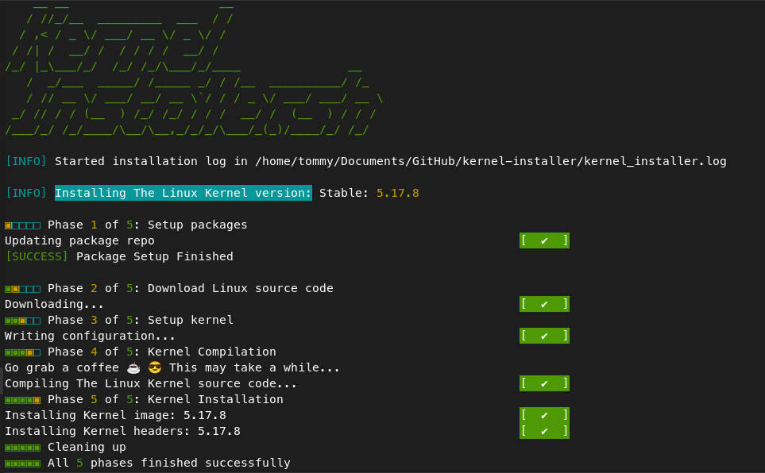

# kernel-installer
Automatic install script for [The Linux kernel](https://www.kernel.org)

Inspired by [LinuxKernelBuild](https://github.com/Angristan/LinuxKernelBuild)

[](https://github.com/tmiland/kernel-installer/releases)
[](https://github.com/tmiland/kernel-installer/blob/main/LICENSE)


### Build and install optimized Linux kernels on Debian, Ubuntu, Fedora and RHEL

Use-case profiles, CachyOS source + BORE, Clang LTO, CPU tuning, named kernels, and QEMU boot verification.

[](https://github.com/tmiland/kernel-installer/blob/main/_images/kernel_installer.png)

### Highlights

- **Use-case profiles** — `--profile desktop|workstation|gaming|server|laptop` applies HZ/preempt/MGLRU/BBR/cgroup settings for the workload.
- **CachyOS source + BORE** — `--source cachyos --sched bore` builds the pinned CachyOS 7.3.4-1 source with `CONFIG_CACHY` and `CONFIG_SCHED_BORE`.
- **CPU tuning** — `--cpu generic|native|zen4|x86-64-v3|x86-64-v4`. `native` needs compiler support; with CachyOS’s Rust config it also needs a rustc with APXF support, otherwise use `x86-64-v3`/`zen4`.
- **Clang LTO** — `--lto thin|full` with `clang`/`lld`.
- **Named kernels** — automatic localversion (`7.3.4-cachyos-workstation-bore`) and `--kernel-tag`.
- **Boot verification** — QEMU boot smoke test in CI for every distro target.

See [Optimization profiles](#optimization-profiles), [CachyOS source and BORE](#cachyos-source-and-bore), and [Kernel naming](#kernel-naming).

### Dependencies

Missing packages are installed when running the script.
```bash
# Debian/Ubuntu
wget curl git rsync fakeroot cpio kmod build-essential patch libncurses-dev xz-utils zstd libssl-dev bc lz4 libelf-dev flex bison gawk debhelper dpkg-dev procps apt-transport-https libdw-dev python3 ca-certificates
# Fedora/RHEL
wget curl git rsync ca-certificates procps-ng findutils diffutils hostname bc binutils bison dwarves elfutils-devel elfutils-libelf-devel flex gawk gcc make patch openssl openssl-devel perl python3 ncurses-devel cpio kmod xz lz4 zstd rpm-build dracut grubby
```
`gnupg` is also installed on demand when tarball verification needs `gpg`/`gpgv`, and `kexec-tools` when `--kexec` is used.

On Debian-based systems `lsb-release` is required; the script offers to install it if it is missing.

### Notes

- This script reverts bug #1086172 [Enable more ZRAM compression options by default](https://bugs.debian.org/cgi-bin/bugreport.cgi?bug=1086172) (kernel 6.12 and newer)
  - Sets default compression to zstd (change it with `--default-compression`), and enables support for the rest of the algorithms
  - Options are:
```bash
lz4 compression support (ZRAM_BACKEND_LZ4) [Y/n/?] y
lz4hc compression support (ZRAM_BACKEND_LZ4HC) [Y/n/?] y
zstd compression support (ZRAM_BACKEND_ZSTD) [Y/n/?] y
deflate compression support (ZRAM_BACKEND_DEFLATE) [Y/n/?] y
842 compression support (ZRAM_BACKEND_842) [Y/n/?] y
lzo and lzo-rle compression support (ZRAM_BACKEND_LZO) [Y/n/?] y
Default zram compressor
  1. lzo-rle (ZRAM_DEF_COMP_LZORLE)
  2. lzo (ZRAM_DEF_COMP_LZO)
  3. lz4 (ZRAM_DEF_COMP_LZ4) (NEW)
  4. lz4hc (ZRAM_DEF_COMP_LZ4HC) (NEW)
> 5. zstd (ZRAM_DEF_COMP_ZSTD)
  6. deflate (ZRAM_DEF_COMP_DEFLATE) (NEW)
  7. 842 (ZRAM_DEF_COMP_842) (NEW)
```

### Download the script

Download, review, then run as root:

```bash
curl -fsSLO https://github.com/tmiland/kernel-installer/raw/main/kernel_installer.sh
sudo bash kernel_installer.sh            # add options as needed, e.g. --stable
```

Quick install with default options:

With Curl:
```bash
curl -fsSL https://github.com/tmiland/kernel-installer/raw/main/kernel_installer.sh | sudo bash
```
With Wget:
```bash
wget -qO - https://github.com/tmiland/kernel-installer/raw/main/kernel_installer.sh | sudo bash
```

With options (e.g. `--stable`):
```bash
curl -fsSL https://github.com/tmiland/kernel-installer/raw/main/kernel_installer.sh | sudo bash -s -- --stable
```

The installer must run as root: pipe into `sudo bash` (as above) or run
`sudo bash kernel_installer.sh`. A run as a regular user exits immediately with a
"must be run as root" error instead of prompting or installing anything.

On systems without sudo, become root first. If the root password is not set:

```bash
sudo passwd root
```

Then:

```bash
su root
```

When run outside a git checkout, a pinned and checksum-verified copy of the
function library (`src/slib.sh`) is fetched automatically.

For latest release

```bash
curl -s https://api.github.com/repos/tmiland/kernel-installer/releases/latest \
| grep "browser_download_url.*sh" \
| cut -d : -f 2,3 \
| tr -d \" \
| wget -qi -
```

The release provides `kernel_installer.sh` and `SHA256SUMS`; `--update` verifies the download against the checksum before replacing the script.

For main branch
```bash
wget https://github.com/tmiland/kernel-installer/raw/main/kernel_installer.sh
```

Set execute permission:
```bash
chmod +x kernel_installer.sh
```
For usage, run:
```bash
./kernel_installer.sh -h
```

### Help output

```bash
Usage:  kernel_installer.sh [options]
  If called without arguments, installs stable kernel 7.3.4 using /opt/linux-kernel

  --help                 |-h   display this help and exit
  --kernel               |-k   kernel version of choice
  --stable               |-s   stable kernel version 7.3.4
  --mainline             |-m   mainline kernel version 7.4-rc2
  --longterm             |-l   longterm kernel version 6.18.63
  --dir                  |-d   install directory
  --kexec                |-x   load new kernel without reboot
  --config               |-c   set configuration target
  --custom-config        |-cc  set custom configuration directive, can be used multiple times
  --profile              |-p   optimization profile (see --list-profiles)
  --list-profiles        |-lp  list optimization profiles and exit
  --base-config          |-bc  profile base config: running, a path, cachyos, or none
  --source               |      kernel source: vanilla (kernel.org) or cachyos (pinned)
  --sched                |      scheduler for the cachyos source: eevdf or bore
  --cpu                  |      CPU tuning: generic, native, zen4, x86-64-v3, x86-64-v4
  --lto                  |      LTO: none, thin, or full (requires clang/lld)
  --hz                   |      timer frequency: 100, 250, 300, 500, 600, 750, 1000
  --bbr3                 |      make BBRv3 the default TCP congestion control (cachyos)
  --binder               |      enable Android Binder IPC and binderfs (Waydroid)
  --sched-ext            |      enable sched_ext and BTF for userspace BPF schedulers
  --kernel-tag           |      custom localversion suffix (default: auto from source/profile)
  --verbose              |-v   increase verbosity
  --get-verified-tarball |-gvt cryptographically verify kernel tarball (default)
  --nproc                |-n   set the number of processing units to use
  --enable-debug-info    |-edi enable debug info
  --lowlatency           |-low convert generic config to lowlatency
  --list-installed       |-li  list installed kernels
  --default-compression  |-dc  select default compression algorithm
  --changelog            |-cl  view changelog for kernel version
  --update               |-upd check for a verified script update
  --uninstall            |-u   uninstall kernel (default: running kernel; use -k for another)

  Installed kernel version: 7.3.4  | Script version: 1.4.0
```

The versions shown are looked up live from kernel.org each time the script runs.

To use opt --kernel:
```bash
./kernel_installer.sh --kernel 5.17.8
```
Else use:
```bash
./kernel_installer.sh --stable, --mainline or --longterm separately
```
To use --dir opt:
```bash
./kernel_installer.sh --dir /path/to/dir
```
The source is downloaded and built in a `linux-kernel` subdirectory (here `/path/to/dir/linux-kernel`, default `/opt/linux-kernel`), which is removed after a successful install. The script refuses to use a directory that is not empty unless it created it in a previous run.

The path passed to `--dir` is the **parent**. It must be owned by you (or root) and must not be group/other-writable unless it is sticky; the installer creates a missing parent with mode `0700`. If it reports `Install directory parent ... is writable by group or others`, run `chmod 700 /path/to/parent` or choose a private directory.
To load [kernel without reboot](https://linux.die.net/man/8/kexec):
```bash
./kernel_installer.sh --kexec
```
To use --config:
```bash
./kernel_installer.sh --config menuconfig
```
default is `olddefconfig`

### Configuration targets

As listed by `make help` in the kernel source (7.3); older kernels may lack some of them.
With the default `olddefconfig`, the build uses the source tree's current
`.config` as its base. Profile builds (`--profile`) default to copying the
running kernel's config (`/boot/config-$(uname -r)`) first; use
`--base-config /path` to choose another config, or `--base-config none` to
keep the historical arch-defconfig behavior.

```bash
config          - Update current config utilising a line-oriented program
nconfig         - Update current config utilising a ncurses menu based program
menuconfig      - Update current config utilising a menu based program
xconfig         - Update current config utilising a Qt based front-end
gconfig         - Update current config utilising a GTK+ based front-end
oldconfig       - Update current config utilising a provided .config as base
localmodconfig  - Update current config disabling modules not loaded
localyesconfig  - Update current config converting local mods to core
defconfig       - New config with default from ARCH supplied defconfig
savedefconfig   - Save current config as ./defconfig (minimal config)
allnoconfig     - New config where all options are answered with no
allyesconfig    - New config where all options are accepted with yes
allmodconfig    - New config selecting modules when possible
alldefconfig    - New config with all symbols set to default
randconfig      - New config with random answer to all options
yes2modconfig   - Change answers from yes to mod if possible
mod2yesconfig   - Change answers from mod to yes if possible
mod2noconfig    - Change answers from mod to no if possible
listnewconfig   - List new options
helpnewconfig   - List new options and help text
olddefconfig    - Same as oldconfig but sets new symbols to their default value without prompting
tinyconfig      - Configure the tiniest possible kernel
```

### Optimization profiles

Profiles apply a small set of kernel configuration changes for an intended
workload. They are starting points, not guarantees: benchmark the result with
your own build/game/server workload.

```bash
./kernel_installer.sh --list-profiles
./kernel_installer.sh --profile workstation
./kernel_installer.sh --profile server --base-config /boot/config-$(uname -r)
./kernel_installer.sh --profile desktop --base-config none
```

A profile build uses the running kernel's config as its base by default, so
the resulting kernel keeps the drivers the machine already uses. Use
`--base-config /path` for another config, or `--base-config none` to start
from the historical arch defconfig (useful in containers and CI). The
repeatable `--custom-config` directives are applied after the profile, so they
can override any profile value.

| Profile | Best for | Key settings |
|---|---|---|
| `desktop` | daily interactive desktop | HZ 1000, full preempt, THP madvise, MGLRU, BBR, O2 |
| `workstation` | LLM/Android builds plus a responsive desktop | desktop + PSI/cgroup CPU limits, BBR default |
| `gaming` | latency-sensitive games | desktop timer/preempt settings, O2 |
| `server` | network/storage throughput | HZ 250, relaxed preempt, MGLRU, BBR default, NR_CPUS 256, O2 |
| `laptop` | battery and thermals | HZ 300, relaxed preempt, schedutil, AMD/Intel P-state, energy model, MGLRU, O2 |
| `lowlatency` | audio/live interactive work (legacy alias) | HZ 1000, full preempt, LATENCYTOP; not PREEMPT_RT |

Notes:

- `--lowlatency` is kept as an alias for `--profile lowlatency`. Combining it
  with a different `--profile` is an error.
- The `workstation`/`server` profiles enable the cgroup knobs systemd needs
  (`MEMCG`, `CGROUP_BPF`, `FAIR_GROUP_SCHED`, `CFS_BANDWIDTH`). Use them with a
  build slice, for example:

  ```bash
  systemd-run --user --scope --slice=build.slice \
    -p CPUWeight=50 -p IOWeight=50 -p MemoryHigh=75% \
    bash -lc 'make -j$(( $(nproc) - 2 ))'
  ```

  The kernel profile reduces scheduler latency; the cgroup is what reserves
  capacity for the desktop under a sustained build.
- `server`/`laptop` use relaxed preemption (`PREEMPT_LAZY` where the kernel
  provides it, otherwise voluntary). On current x86 kernels the old
  `PREEMPT_NONE`/`PREEMPT_VOLUNTARY` choices are not both available.
- BBR: `workstation`/`server` make it the default (`DEFAULT_BBR`); the other
  profiles enable the module but leave the default congestion control alone.
  Use `sysctl net.ipv4.tcp_congestion_control=bbr` and
  `sysctl net.core.default_qdisc=fq` if you want BBR at runtime.
- Not included in the first cut: BORE/CACHY (require the CachyOS patchset),
  sched_ext (requires `DEBUG_INFO_BTF` and `pahole`, which conflicts with the
  default debug-info-off build), O3 (not exposed by vanilla 7.3.4; CachyOS
  carries an out-of-tree O3 option), LTO, and native CPU tuning. These are
  separate follow-ups.

### CachyOS source and BORE

The CachyOS source tree carries the CachyOS base patchset (`CONFIG_CACHY`).
It is pinned to **7.3.4-1** and verified with the CachyOS release keys; the
config and BORE patch are pinned by commit and SHA256.

```bash
sudo ./kernel_installer.sh -d /path/to/parent \
  --source cachyos --sched bore --profile workstation
# resulting kernel release: 7.3.4-cachyos-workstation-bore
```

- `--source cachyos` builds the pinned CachyOS source instead of kernel.org.
  It uses the pinned CachyOS config by default, so `--base-config cachyos` is
  implied; `--base-config running`, a path, or `none` still override it.
  Version options (`--stable`, `--mainline`, `--longterm`, `--kernel`) are only
  accepted if they match the pinned 7.3.4 source.
- `--sched bore` applies the pinned BORE scheduler patch and enables
  `CONFIG_SCHED_BORE=y` plus `CONFIG_CACHY=y`. It requires
  `--source cachyos`: the BORE patch does not apply cleanly to the vanilla
  kernel.org 7.3.4 tree. `--sched eevdf` is the default and does not apply
  the BORE patch.
- CI builds and boots the BORE kernel with Clang ThinLTO on Debian 13 and
  Ubuntu 24.04, with the `workstation` profile. Native CPU tuning is available
  but is not part of the default CI matrix because it depends on the build
  host's toolchain.
- Checkout runs verify the CachyOS source with `src/keys/cachyos.asc`; piped
  runs fetch the same pinned fingerprints from keys.openpgp.org.
- The CachyOS pins live in `kernel_installer.sh` (`CACHYOS_*`). Update the
  source tag, PKGBUILD revision, config SHA256, patch revision and patch
  SHA256 together; a mismatch fails closed.
- `--cpu generic|native|zen4|x86-64-v3|x86-64-v4` selects the CPU target.
  `generic` is the default and portable. `native` uses `X86_NATIVE_CPU` and
  builds for the machine doing the build (it may not boot optimally on another
  machine). `zen4`, `x86-64-v3`, and `x86-64-v4` require `--source cachyos`;
  they use the CachyOS `MZEN4`/`X86_64_VERSION` options.
- `--lto none|thin|full` enables Clang LTO. `thin`/`full` install
  `clang`, `lld`, and `llvm` on demand, configure `LTO_CLANG_THIN`/`FULL`, and
  build with `LLVM=1 LLVM_IAS=1`; `none` is the default. The kernel is
  boot-smoked after the build.
- This is the CachyOS base patchset plus BORE, not the full CachyOS variant
  matrix. BMQ and the remaining wiki features are separate follow-ups;
  sched_ext is available through `--sched-ext`.

### Kernel naming

Optimized builds get a `CONFIG_LOCALVERSION` so they are distinguishable in
`uname -r`, `/lib/modules`, the headers package, DKMS, initramfs, GRUB and the
`.deb` names:

```text
<version>-<source>-<profile>[-<scheduler>][-<cpu>][-<lto>][-hz<n>][-bbr3][-binder][-sched-ext]
```

| Build | `uname -r` |
|---|---|
| CachyOS BORE workstation, generic CPU, no LTO | `7.3.4-cachyos-workstation-bore` |
| same + native CPU | `7.3.4-cachyos-workstation-bore-native` |
| same + native + ThinLTO | `7.3.4-cachyos-workstation-bore-native-lto` |
| same + 600 Hz + BBR3 + Binder + sched_ext | `7.3.4-cachyos-workstation-bore-hz600-bbr3-binder-sched-ext` |
| CachyOS EEVDF server | `7.3.4-cachyos-server` |
| vanilla desktop | `7.3.4-vanilla-desktop` |

`--kernel-tag <suffix>` overrides the generated suffix. The default vanilla
build without a profile stays untagged. `CONFIG_LOCALVERSION_AUTO` is disabled
for named builds. A new localversion is a new kernel release, so DKMS modules
must be rebuilt for it; the installer warns when `dkms status -k <release>`
finds no modules. Rebuild them for the named release with:

```bash
# use the release printed by the installer
sudo dkms autoinstall -k 7.3.4-cachyos-workstation-bore
# or, after booting that kernel:
sudo dkms autoinstall -k "$(uname -r)"
```

Use the full release for removal, e.g. `--uninstall -k "$(uname -r)"`
(the default without `-k`).

### Build configuration options

These flags are applied after the profile and before `--custom-config`:

| Option | Effect | Notes |
|---|---|---|
| `--hz <n>` | `CONFIG_HZ=n` plus the matching `HZ_<n>` | 100/250/300/1000 on both sources; 500/600/750 require `--source cachyos` |
| `--bbr3` | BBRv3 as the default TCP congestion control | CachyOS source only; per-socket override remains |
| `--binder` | Android Binder IPC and binderfs | for Waydroid; already enabled by the CachyOS config |
| `--sched-ext` | `SCHED_CLASS_EXT` and BTF | kernel 6.12+; re-enables debug info, installs `dwarves` (pahole); heavier build |

`--sched-ext` does not replace BORE at build time. It enables the sched_ext
class; run a userspace scheduler such as `scx_rusty` or `scx_lavd` to attach
one, and stop it to return to the default scheduler. The debug info and BTF
that sched_ext needs increase the build time and vmlinux size.

The flags are part of the localversion, so builds that differ only by these
options do not collide in `/lib/modules` or DKMS:

```text
7.3.4-cachyos-workstation-bore-lto-hz600-bbr3-binder-sched-ext
```

### Custom configuration directives

In order to enable specific kernel configs, one can use `--custom-config` like the following example:
```
./kernel_installer.sh --custom-config "scripts/config --set-val CONFIG_DM_VDO m"
```

The directive must be a `scripts/config` command; raw `CONFIG_*` assignments (e.g. `CONFIG_DM_VDO=y`) are not accepted.

Note that `--custom-config` can be used multiple times like:
```
./kernel_installer.sh --custom-config "scripts/config --set-val CONFIG_DM_VDO m" --custom-config "scripts/config --set-val CONFIG_KERNEL_ZSTD y"
```

### Boot smoke test

`scripts/boot-smoke.sh` boots the installed kernel in QEMU with a minimal
initramfs and requires a `BOOT_SMOKE_OK` marker on the serial console. CI runs
it after installation in every distro install job, including the profile
smoke job. It proves that the built kernel image boots; it is not a full-OS
boot or a performance benchmark.

```bash
./scripts/boot-smoke.sh --version "$(uname -r)"
```

Requires QEMU, a static C compiler, `cpio`, and `mknod` as root (or run it
under `fakeroot`). Use `--timeout` to change the 180-second limit.

### Tarball verification

Stable, longterm and `--kernel` tarballs are cryptographically verified by default
(`--get-verified-tarball` is accepted but no longer needed). The `sha256sums.asc`
file is checked against the kernel.org autosigner key, and the tarball against
the Linus Torvalds / Greg Kroah-Hartman signatures. Checkout runs use the
bundled `src/keys/kernel.org.asc`; piped runs fetch the keys via WKD.
 - [Linux kernel releases PGP signatures](https://www.kernel.org/category/signatures.html)
 - Source script [get-verified-tarball](https://git.kernel.org/pub/scm/linux/kernel/git/mricon/korg-helpers.git/tree/get-verified-tarball)
 - Installs `gnupg` if `gpg`/`gpgv` are not available
 - A throwaway keyring is used by default; set `GNUPGHOME=/path` to reuse one. Keys are selected by exact address and exported by fingerprint (a user ID that merely contains the address is not trusted)
 - Mainline snapshots from git.kernel.org are not signed and are not verified

To skip verification:
```bash
GET_VERIFIED_TARBALL=0 ./kernel_installer.sh
```

Used together:
```bash
./kernel_installer.sh --stable --config menuconfig --kexec --dir /path/to/dir
```

Watch install log:
```bash
tail -f /var/log/kernel-installer/kernel_installer.log
```

- installation log in `/var/log/kernel-installer/kernel_installer.log` (a root-only directory), started fresh on every install; the previous install's log is kept as `kernel_installer.log.1` in the same directory, and `--list-installed` / `--uninstall` leave both alone
- set `LOGFILE` to log somewhere else, e.g. `LOGFILE=/root/kernel-build.log ./kernel_installer.sh`
- when the output is not a terminal (a pipe, a file, CI), the spinner and colors are turned off
- [./src/slib.sh](https://github.com/tmiland/kernel-installer/blob/main/src/slib.sh) function script is sourced remotely if not found locally
  - This script is a combination of functions for spinners, colors and logging
    - Source: Spinner: [swelljoe/spinner](https://github.com/swelljoe/spinner)
    - Source: Run ok: [swelljoe/run_ok](https://github.com/swelljoe/run_ok)
    - Source: Slog: [swelljoe/slog](https://github.com/swelljoe/slog)
    - Source: Slib: [virtualmin/slib](https://github.com/virtualmin/slib)

**Full write-up on the blog:** https://tmiland.com/kernel-installer/
## Uninstall kernel

To uninstall previously installed kernel:
```bash
./kernel_installer.sh --uninstall --kernel 5.17.7
```

- The `linux-image-<version>` and `linux-headers-<version>` packages (Fedora/RHEL: `kernel-<version>` and `kernel-devel-<version>`) are removed
- On Debian-based systems `apt` asks for confirmation; on Fedora/RHEL they are removed without a prompt

## Testing

Tested and working on: Debian 12/13, Ubuntu 22.04/24.04 and Fedora 44 (see [test-install.yml](.github/workflows/test-install.yml))

- Each CI run uploads the installer log of every distro as a workflow artifact (`kernel-installer-logs-<distro>`) on the [Actions](https://github.com/tmiland/kernel-installer/actions/workflows/test-install.yml) page

## Maintenance

### Updating the vendored slib

`src/slib.sh` is a curated subset of [virtualmin/slib](https://github.com/virtualmin/slib) (tracked via [tmiland/slib](https://github.com/tmiland/slib)). Updates are two-phase, and CI enforces the second one on `main`:

```bash
# Phase 1 - vendor the new file (defaults to tmiland/slib@master)
scripts/update-slib.sh
git add src/slib.sh && git commit -m 'chore: update vendored slib.sh' && git push

# Phase 2 - pin the pushed commit (updates SLIB_REV / SLIB_SHA256)
scripts/update-slib.sh --finalize <commit>
git add kernel_installer.sh && git commit -m 'chore: bump slib pin' && git push
```

- Use `--source virtualmin/slib` to pull upstream directly. Sync your fork first with `gh repo sync tmiland/slib -b master`.
- Sources contain extra Virtualmin-only helpers and are not lint-clean as-is (e.g. `#!/bin/sh` shebang); the vendored copy is a trimmed, lint-clean subset. Review `git diff src/slib.sh` and the helper's shellcheck output before committing.
- Until phase 2 lands on `main`, the `slib pin` CI job fails (that is the reminder).

## Feature request and bug reports
- [Bug report](https://github.com/tmiland/kernel-installer/issues/new?assignees=tmiland&labels=bug&template=bug_report.md&title=Bug-report:)
- [Feature request](https://github.com/tmiland/kernel-installer/issues/new?assignees=tmiland&labels=enhancement&template=feature_request.md&title=Feature-request:)

## Donations
<a href="https://www.buymeacoffee.com/tmiland" target="_blank"></a>
- [PayPal me](https://paypal.me/milandtommy)
- [BTC] : 33mjmoPxqfXnWNsvy8gvMZrrcG3gEa3YDM

#### Disclaimer 

*** ***Use at own risk*** ***

### License

[MIT License](https://github.com/tmiland/kernel-installer/blob/main/LICENSE)
